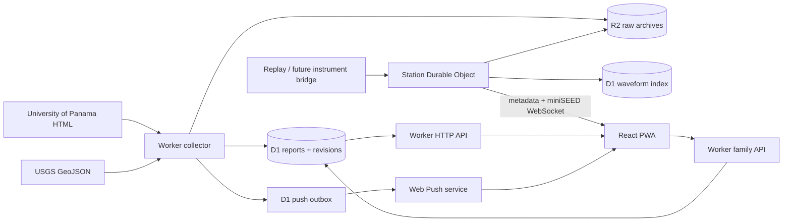

# Architecture

## Two separate data paths

Agency reports are discrete, revisable observations. Station waveforms are continuous sampled signals. They have different latency, identity, and storage needs.

Cloudflare fits the initial scale: ordinary HTTP/cron for catalogs, Durable Objects for station ordering and fan-out, D1 for queryable metadata and family records, R2 for original data. React keeps the waveform canvas and globe rendering on the device. Phoenix/LiveView would be a reasonable alternative for an Elixir-oriented team, but the present architecture needs no extra application server. LiveStore/local-first replication could improve multi-device offline collaboration later; an explicit pending queue is easier to audit for the first check-in model.

## miniSEED instead of inventing a waveform format

The station boundary uses miniSEED 2, not arrays of JSON numbers or custom protobuf samples. One WebSocket JSON envelope carries routing/replay metadata, followed immediately by the unchanged binary miniSEED record. This keeps established seismology tooling useful. A physical station bridge can read SeedLink or instrument output and submit records; the Worker is not a SeedLink server. miniSEED 3 is not implemented.

The original fixture uses compressed records covering longer spans. The replay tool decodes its EHZ channel and repacks unchanged counts into one-second int32 miniSEED records to exercise low-latency transport. Header origin timestamps remain intact. The browser uses seisplotjs for decoding and a bounded ring buffer/canvas for display. It has no detector, magnitude estimator, or calibrated acceleration conversion.

A seismogram is a time series of measured ground motion, which provides the desired moving trace. Connection status/last-received time is a separate heartbeat. A connected socket with no new samples must not imply a healthy instrument. Raw counts and auto-scaled traces cannot be compared as physical shaking across uncalibrated sensors.

## Identity, revisions, and freshness

USGS event IDs are retained. UP has no exposed immutable identifier; its detail page renders the query parameters rather than looking up a catalog ID. The collector reconciles consecutive index snapshots. Exact current origin-time matches take precedence. A missing active row can retain its internal ID through a correction only when there is an unambiguous one-to-one replacement within five seconds, 20 km and 0.6 magnitude. Coexisting rows remain distinct. This is a conservative identity inference, not agency-provided linkage; larger or ambiguous corrections remain separate archived identities. Missing rows within the current snapshot's covered interval are marked withdrawn and omitted from the active catalog; aging out of the rolling window alone is not a withdrawal. Withdrawn rows and revisions remain in D1 for audit. Corrections keep the same map ID and do not enqueue another new-report notification. Agencies remain separate.

A source-specific D1 lease prevents overlapping collection runs. Fingerprints are compared in memory after one catalog read; all changed reports, revision inserts and withdrawals commit in a single D1 batch. An invalid UP page cannot withdraw the last good catalog.

Raw HTML/JSON and normalized revisions are archived. An upstream error leaves the last good data available with an error/freshness indicator. UP's timestamps are interpreted in Panama UTC−5. All storage/API timestamps are UTC epoch milliseconds; the UI formats Panama time.

Public catalog reads use five-second edge snapshots, with one shared client poll for the map and sound where their queries match. See [capacity and freshness](scaling.md) for latency budgets, the private active-session estimate, and measured local load results.

## Stream reliability

Each station has its own Durable Object. Ingest is serialized there. `(station, session, sequence)` identifies a record; an exact retry succeeds without another broadcast, conflicting bytes/timestamps return 409. R2 and D1 writes are not a distributed transaction; the archive key is deterministic so a retry can complete an interrupted insertion. This is at-least-once upload with idempotency, not end-to-end exactly-once delivery.

Out-of-order records are archived without rewinding the live view. Live mode requires the displayed timestamp to match the instrument header. Replay mode may map the record onto a new display timeline. A DO keeps 24 recent records in memory and the latest metadata in durable storage; hibernation/restart clears the memory replay. Clients reconnect with backoff. The browser retains at most 360 records and five minutes, shows gaps, and freezes a separate snapshot when paused. Archive downloads are available; automatic historical backfill is not implemented.

The prototype caps station viewers at 200 and records at 64 KiB. It has not been load-tested at that limit and has no application-level slow-consumer acknowledgement/backpressure protocol. Before broad distribution, measure fan-out and implement lagging-viewer handling, archive batching/retention, and durable instrument-side spooling. Stations should be authenticated individually, time-synchronized, and assigned one channel per stream or sequential sequence IDs across channels.

## Family state

A circle is a lasting group. Membership links to a person record; additional people can be tracked without installing the app. All members can submit attributed check-ins, including proxy confirmations. Owners alone rename the circle and edit its suggested gathering location. Each check-in is immutable apart from explicitly removable coordinates, with contact time, server receipt time, note, optional place, and optional historical context. There is no incident version controlling the current board. Latest-per-person/kind queries are independent of paginated history, so a quiet person's last update cannot fall off a fixed history window.

Each device holds a separate bearer membership per circle and a selected circle ID. Caches and offline queues use the circle ID, and the board component is keyed by membership token. Unmounted fetches cannot update another circle. Offline drafts keep the original time/place/location consent; same-ID retries are idempotent, differing payloads conflict. Clearing old coordinates makes a retry carrying those coordinates conflict rather than restore removed sharing.

Invitation and membership tokens are hashed server-side. Multiple invitations coexist, expire after seven days, and are revocable by their issuer or circle owner. Link secrets live in URL fragments and are sent only in POST bodies; links open a name/confirmation screen. Existing saved membership opens the circle without duplicating it. Circle APIs enforce group isolation. Invite previews reveal only the circle name and ID to holders of a valid invitation.

Geolocation permission and circle-sharing consent are separate. A self check-in can include a one-time browser fix; proxy check-ins cannot. The server validates latitude, longitude, accuracy, and capture time relative to the check-in, and enforces subject identity. The circle map shows at most 24-hour-old latest snapshots, with time/accuracy, and separate named gathering spots. Only the reporting member can clear their own coordinates from all their circle history. Spot creators and owners can remove gathering spots. No location is collected continuously. Offline member caches may retain previously fetched data until refreshed; this is shared information, not remotely retractable memory.

This remains device-token authentication, without verified global identity, owner recovery, or merging new-device memberships. Owners can revoke member access, which also revokes outstanding invite links; historical attribution remains intact. The server can read circle data; end-to-end encryption is not implemented. Production enforces per-IP read/write rate limits. Public raw-source archives expire after 30 days, normalized reports and circle history are retained, and members can remove shared coordinates. Earthquake catalogs are public; circle data is authenticated and never included in public earthquake feeds.

## Notifications

The browser registers through Web Push only after a button press. A subscription chooses one source and a minimum magnitude, within the Panama region (5–11°N, 84–76°W). Qualifying reports must be at most 15 minutes old and arrive incrementally after a successful collection within the preceding five minutes. First imports and catch-up after a longer outage establish a silent baseline. An explicit `new_report_at` field drives both map highlights and sound; `first_seen` remains audit information. The persistent outbox expires jobs after 15 minutes and retries failures on collection runs. Gone subscriptions are removed. Revisions do not repeatedly notify the same device. Successful dispatch means push-service acceptance, not receipt by the person. Family check-in notifications are not yet implemented.

## References

- [FDSN miniSEED](https://www.fdsn.org/seed_manual/)
- [FDSN SeedLink](https://docs.fdsn.org/projects/seedlink/en/latest/)
- [ObsPy example data](https://examples.obspy.org/)
- [USGS GeoJSON feeds](https://earthquake.usgs.gov/earthquakes/feed/v1.0/geojson.php)
- [University of Panama](https://sismosgeociencias.up.ac.pa/)
- [Cloudflare local development](https://developers.cloudflare.com/workers/development-testing/)
